# 트라이로그 (Trylog) · 사장님의 작은 장사 비서

> **내가 바꾼 장사, 얼마나 달라졌을까?**
> 해볼 일을 찾고, 한마디로 남기고, 지난번에 해본 일의 결과를 같이 봅니다.

2026 서울 AI 디지털 배움터 청년 해커톤(트랙 B) 출품작입니다. 가게를 직접 운영하는 소상공인이 가게에서 바꿔 본 일(시도)을 말 한마디로 기록하고, 결과 확인일에 판매 자료로 전후를 비교하고, 다음에 해볼 일을 고르도록 돕는 웹 서비스입니다.

**서비스 주소** · https://hgkim-mini-pc.taild27e83.ts.net/try-log/

<p align="center">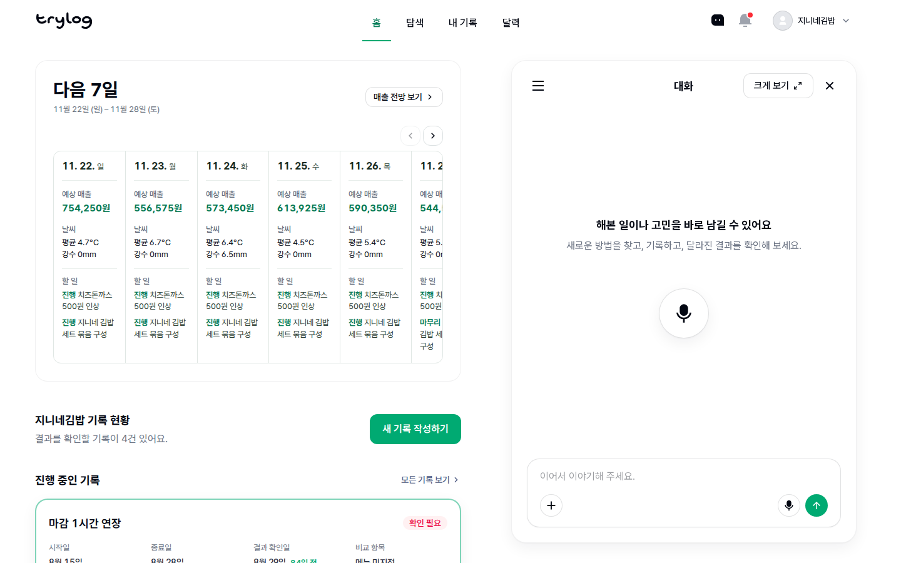</p>

---

## 목차

1. [왜 만들었나](#왜-만들었나)
2. [주요 기능](#주요-기능)
3. [시스템 구조](#시스템-구조)
4. [AI 에이전트](#ai-에이전트)
5. [매출 예측 ML](#매출-예측-ml)
6. [전후 비교 계산](#전후-비교-계산)
7. [보안과 운영](#보안과-운영)
8. [기술 스택](#기술-스택)
9. [폴더 구조와 실행](#폴더-구조와-실행)
10. [테스트](#테스트)

---

## 왜 만들었나

메뉴판에 '사장님 추천' 표시를 붙이는 일은 오늘 바로 할 수 있습니다. 그런데 2주 뒤 그 메뉴가 정말 더 팔렸는지 보려면 바꾼 날짜부터 다시 찾고, POS 화면에서 전후 기간의 메뉴별 주문 수를 따로 뽑아 비교해야 합니다. 바꾼 일은 흩어지고, 결과는 보지 못한 채 다음 결정을 하게 됩니다.

트라이로그는 이 흐름을 하나로 잇습니다.

| 단계 | 사장님이 하는 일 | 트라이로그가 하는 일 |
| --- | --- | --- |
| 찾기 | 장사 고민을 말한다 | 비슷한 가게가 해본 일 가운데 비용과 난이도가 맞는 것을 제안한다 |
| 남기기 | "오늘부터 2주 동안 쌀떡볶이에 추천 스티커 붙였어" | 기록 이름, 진행 기간, 결과 확인일, 비교할 숫자를 정리해 확인받고 저장한다 |
| 확인하기 | 확인일에 기록을 연다 | 같은 길이의 전후 기간으로 주문 수와 메뉴 비중을 계산해 보여 준다 |
| 다음 결정 | 계속할지, 하나만 바꿔 다시 볼지 고른다 | 결과를 근거로 다음 기록을 이어서 만든다 |

---

## 주요 기능

### 1. 말 한마디로 기록하기

평소 말투로 말하거나 적으면 AI 에이전트가 기록 초안을 만듭니다. "2주 동안"은 날짜로, "쌀떡볶이"는 가게의 메뉴 코드로 바꾸고, 빠진 항목이 있으면 하나씩 되묻습니다. 사장님이 "저장"이라고 해야 저장되고, 틀린 곳은 "일주일 더 할게"처럼 말로 고칩니다.

음성으로도 대화할 수 있습니다. 마이크를 한 번 누르고 말한 뒤 1초 동안 조용하면 자동으로 보내고, 답은 화면에 쓰는 동시에 소리로 읽어 줍니다.

<p align="center">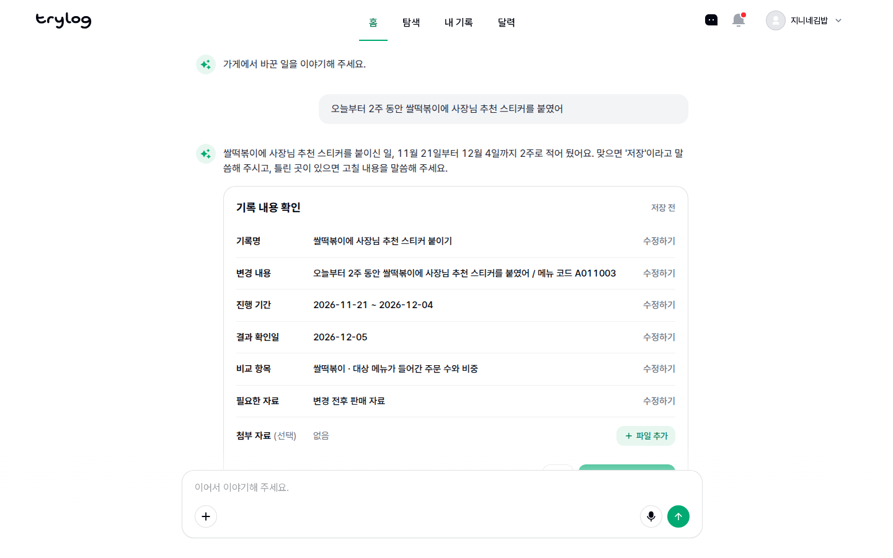</p>

### 2. 고민 상담과 동네 사례

"요즘 점심시간에 손님이 줄었어요"처럼 고민을 말하면, 비슷한 상황의 가게가 해본 일 가운데 맞는 사례를 최대 두 개 골라 줍니다. 카드에서 바로 "시도해보기"를 누르면 그 사례로 기록 초안이 만들어집니다. 탐색 화면에서는 분야와 비용(0원만 보기)으로 사례를 고르고, 상세 화면에서 비슷한 가게의 결과 분포를 봅니다.

<p align="center">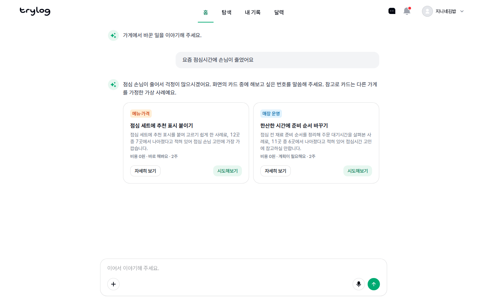</p>

| 동네 사례 탐색 | 사례 상세 |
| --- | --- |
| 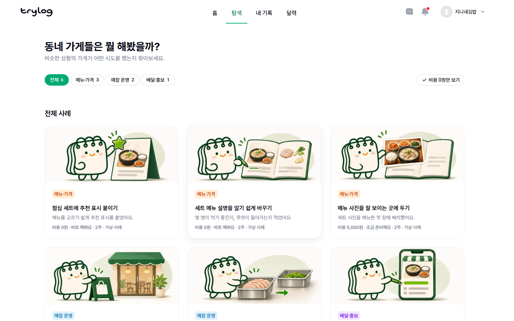 | 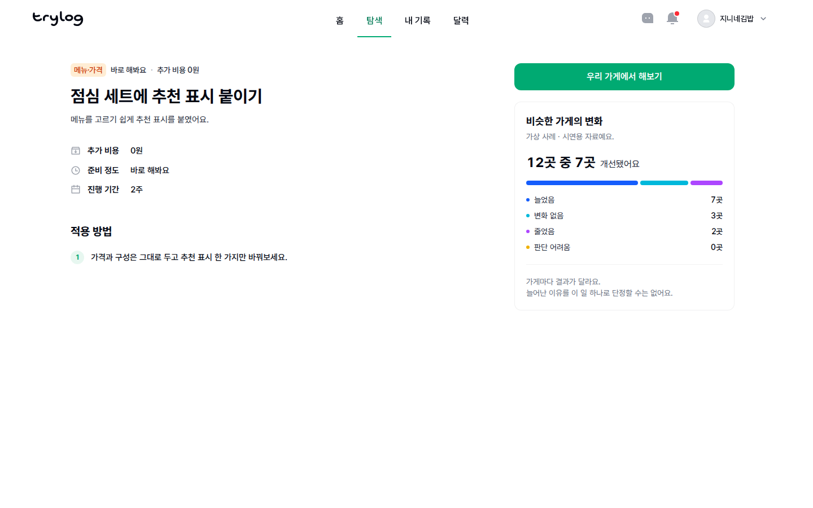 |

> 동네 사례와 그 결과 분포는 시연용 가상 자료이며, 화면에도 '가상 사례'로 표시합니다.

### 3. 내 기록과 달력

저장한 기록은 상태(확인 필요, 진행 중, 시작 예정, 완료, 중단)별로 모아 보고, 달력에서 진행 기간과 결과 확인일을 날짜에 맞춰 봅니다. 달력에는 앞으로 7일의 예보 기온과 강수도 함께 표시합니다.

| 내 기록 | 달력 |
| --- | --- |
| 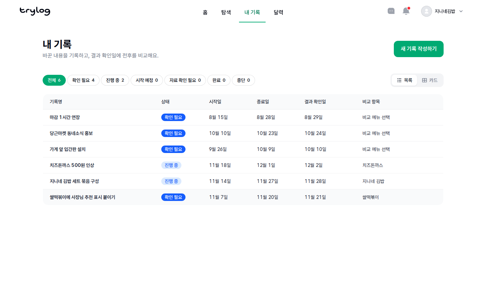 | 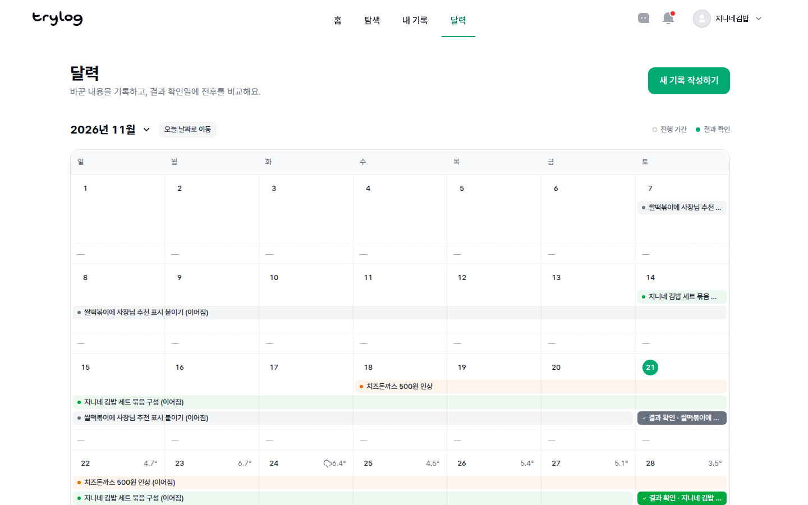 |

### 4. 결과 확인: 전후 비교

결과 확인일에 기록을 열고 비교할 메뉴를 고르면, 가게의 POS 주문(DB)이나 올린 CSV·XLSX 파일로 같은 길이의 전후 기간을 비교합니다. 메뉴 주문 수만 보지 않고 전체 주문과 비중을 함께 보여 줘서 "주문은 늘었지만 비중은 줄었다" 같은 경우도 놓치지 않습니다. 비교 기준과 한계(날씨, 행사, 다른 변화는 반영하지 않음)를 함께 적고, 효과를 단정하지 않습니다.

| 자료 올리기 | 비교 결과와 다음에 해볼 일 |
| --- | --- |
| 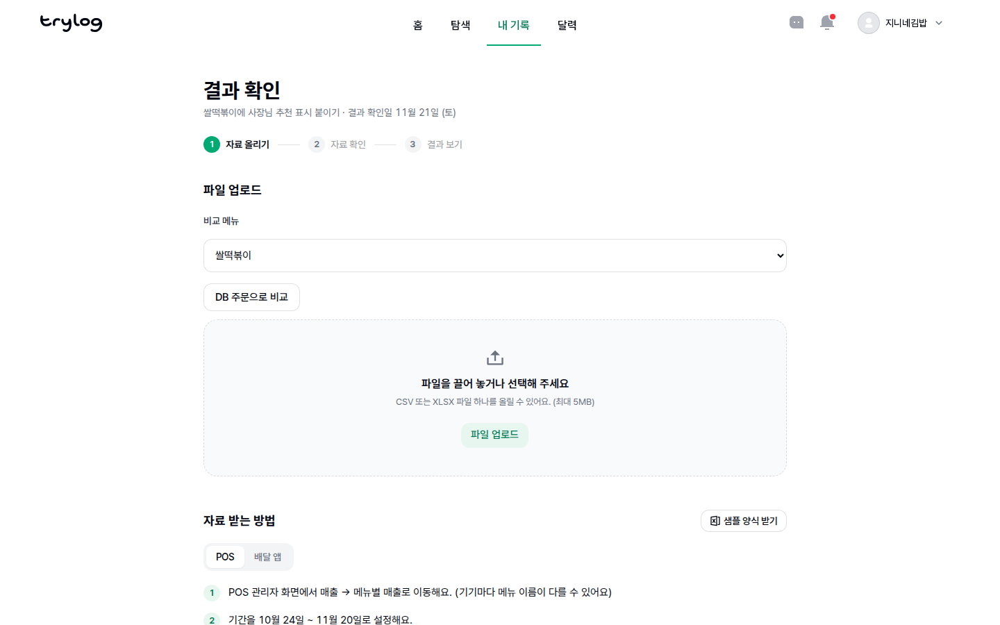 | 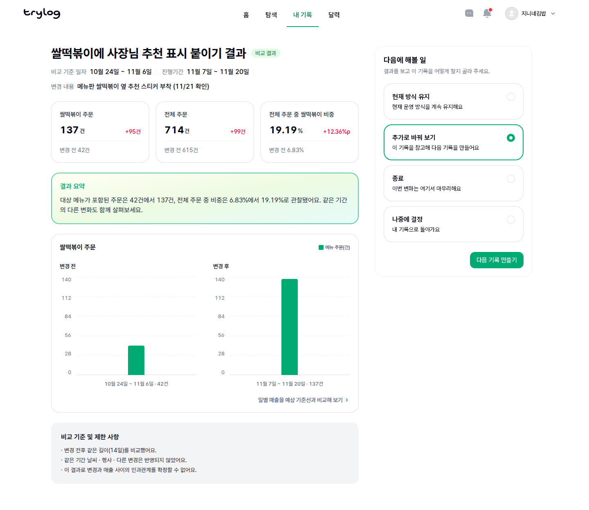 |

### 5. 앞으로 7일 예상 매출

홈과 매출 전망 화면에서 내일부터 7일간의 날짜별 예상 매출, 날씨, 그날 진행 중인 기록을 함께 봅니다.

<p align="center">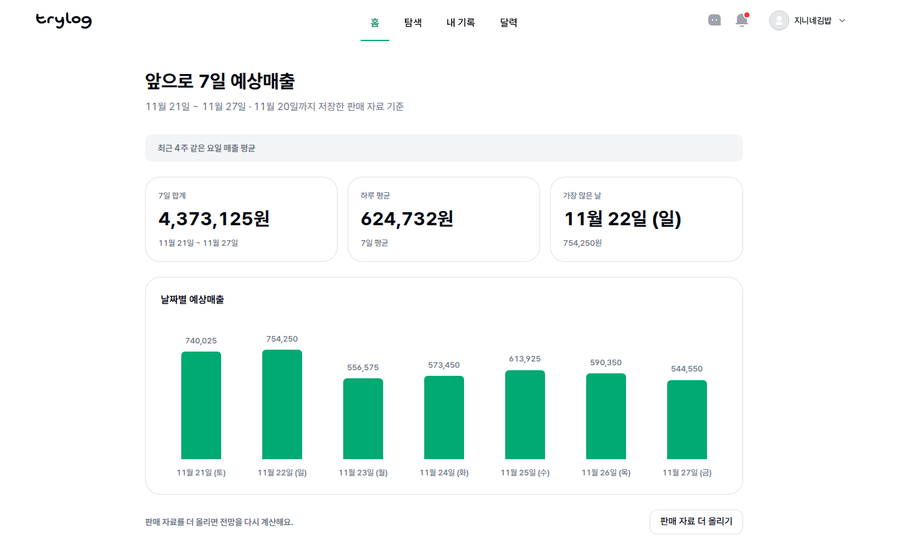</p>

### 6. 휴대폰에서도

넓은 화면(1280px 이상)에서는 본문과 대화창을 나란히 쓰고, 좁은 화면에서는 대화창이 본문 위에 뜨고 기록 표가 카드로 바뀝니다.

<p align="center">
  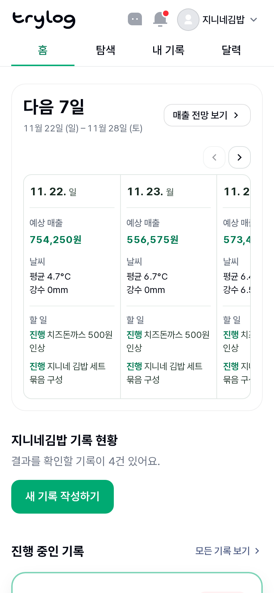
  &nbsp;&nbsp;
  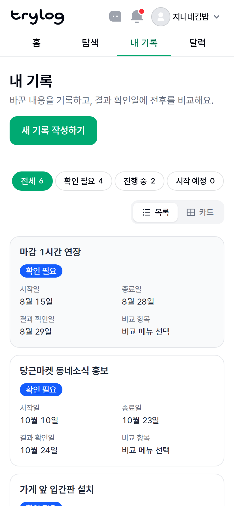
</p>

---

## 시스템 구조

<p align="center">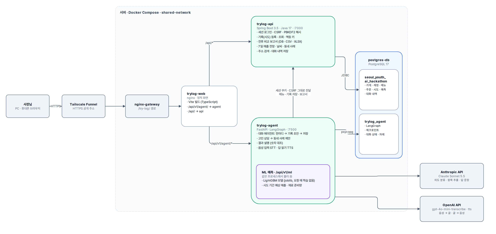</p>

한 대의 서버에서 Docker Compose로 컨테이너 세 개를 띄우고, 같은 Docker 네트워크의 공용 PostgreSQL에 연결합니다. 바깥에서는 Tailscale Funnel(HTTPS)과 nginx 게이트웨이의 `/try-log/` 경로로만 들어오며, 각 서비스의 포트는 서버 안(`127.0.0.1`)에만 열려 있습니다.

| 컨테이너 | 기술 | 맡은 일 |
| --- | --- | --- |
| `trylog-web` | nginx | Vite로 빌드한 화면을 제공하고, `/api/v1/agent/`는 에이전트로, 나머지 `/api/`는 Spring으로 넘깁니다. |
| `trylog-api` | Spring Boot 3.5 · Java 17 | 로그인과 세션, 기록 등록과 조회, 전후 비교 보고서, 7일 매출 전망, 주소 검색, 대화 내역 저장을 맡습니다. 업무 테이블을 읽고 쓰는 곳은 이 서버뿐입니다. |
| `trylog-agent` | FastAPI · LangGraph | 대화 에이전트, 음성 전사(STT)와 답 읽기(TTS), 결과 설명을 맡습니다. ML 예측 코드(`ml/`)를 같은 프로세스에 불러와 `/api/v1/ml` 경로로도 제공합니다. |
| `postgres-db` | PostgreSQL 17 | `seoul_youth_ai_hackathon` 스키마에 가게, 계정, 메뉴, 주문, 기록, 예측, 대화 내역을, `trylog_agent` 스키마에 에이전트의 대화 상태를 따로 둡니다. |

**요청 하나의 흐름 (대화로 기록 저장)**

1. 브라우저가 `/try-log/api/v1/agent/chat`에 사장님 말을 보냅니다. 로그인 세션 쿠키와 CSRF 토큰이 함께 갑니다.
2. 에이전트는 그 쿠키와 토큰을 그대로 Spring에 넘겨 로그인한 가게와 메뉴를 확인합니다. 에이전트는 DB의 업무 테이블에 직접 쓰지 않습니다.
3. Claude가 말을 이해하고, 코드가 날짜와 메뉴 코드를 정하고 검증합니다. 확인을 받을 차례면 그래프가 멈추고, 그 상태를 Postgres에 저장합니다.
4. 사장님이 "저장"이라고 하면 에이전트가 Spring의 `POST /experiments`를 부르고, Spring이 권한과 입력을 다시 검사해 저장합니다.

---

## AI 에이전트

<p align="center">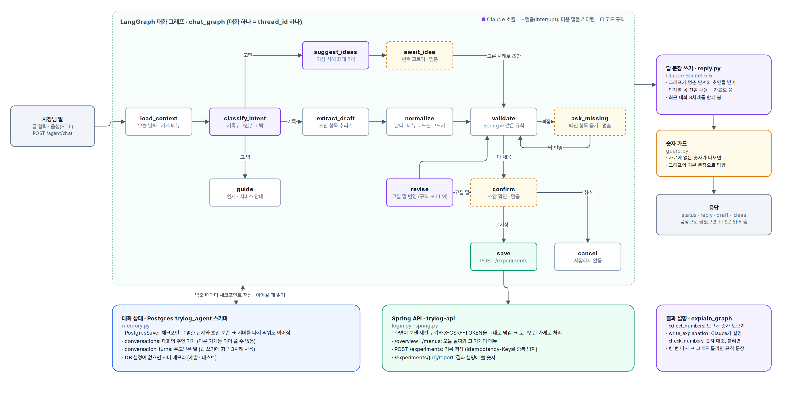</p>

> 다이어그램 원본(`.github/readme/*.drawio`)은 [draw.io](https://app.diagrams.net)에서 바로 열어 고칠 수 있습니다.

### 설계 원칙

**흐름은 코드가, 말은 LLM이 맡습니다.**
대화의 단계(무엇을 묻고, 언제 확인받고, 언제 저장할지)는 LangGraph 상태 그래프가 정합니다. Claude Sonnet 5.5는 세 가지만 합니다.
- 사장님 말의 의도(기록, 고민, 그 밖)를 가르고 항목을 뽑습니다. 분류와 추출은 호출 한 번에 끝냅니다.
- 고민에 맞는 사례를 고릅니다.
- 사장님께 드릴 답 문장을 씁니다.

날짜 계산, 메뉴 코드 찾기, 입력 검증, 저장은 모두 코드가 합니다.

**숫자는 자료에 있는 것만 씁니다.**
답 문장과 결과 설명에서 숫자를 모두 꺼내, 코드가 넘겨준 자료(초안의 날짜와 기간, 보고서 수치, 사례에 적힌 숫자)에 있는지 대조합니다(`tools/guard.py`).
- 답 문장에 자료에 없는 숫자가 하나라도 있으면, 그래프가 정한 기본 문장으로 답합니다.
- 결과 설명은 한 번 다시 쓰게 하고, 그래도 틀리면 숫자만 끼워 넣은 규칙 문장을 씁니다.

**멈췄다가 이어가는 멀티턴 대화.**
- 질문(`ask_missing`), 초안 확인(`confirm`), 사례 고르기(`await_idea`)에서 LangGraph `interrupt`로 멈추고, 다음 말이 오면 그 자리에서 이어갑니다.
- 상태는 `PostgresSaver` 체크포인트로 저장하므로 에이전트를 다시 띄우거나 여러 개 띄워도 대화가 이어집니다.
- 대화마다 주인 가게를 기록해 다른 가게는 이어 쓸 수 없고, 30일 동안 말이 없던 대화는 정리합니다.
- 멈추는 노드에는 글을 만드는 일만 두고, LLM 호출과 저장은 다른 노드에서 합니다. 이어갈 때 노드가 다시 실행돼도 중복 호출이나 중복 저장이 생기지 않습니다.

**로그인과 권한은 Spring에 맡깁니다.**
에이전트는 화면이 보낸 세션 쿠키와 `X-CSRF-TOKEN`을 Spring 호출에 그대로 넘깁니다. 그래서 에이전트가 무엇을 하든 Spring이 '로그인한 그 가게의 요청'으로 다시 검사합니다. 저장에는 `Idempotency-Key`를 붙여 같은 기록이 두 번 생기지 않습니다.

**LLM이 없어도 서비스는 돕니다.**
- 키가 없거나, 호출이 실패하거나, 요청에 남은 시간이 모자라면 규칙 기반 이해와 기본 문장으로 답합니다. 응답의 `source`가 `RULES`로 표시됩니다.
- LLM 한 번 호출의 제한 시간은 8초입니다.
- 서버를 띄울 때 미리 몇 번 호출해 첫 응답이 늦지 않게 합니다.

### 음성 대화

| 단계 | 구현 |
| --- | --- |
| 말 끝 감지 (브라우저) | `MediaRecorder`로 녹음하면서 Web Audio `AnalyserNode`로 소리 크기를 잽니다. 처음에 주변 소음을 재서 기준을 정하므로 시끄러운 가게에서도 동작합니다. 말이 끝나고 1초 조용하면 녹음을 마치고, 8초 동안 말이 없으면 취소합니다. |
| 말 → 글 (`POST /agent/stt`) | OpenAI `gpt-4o-mini-transcribe`. 로그인한 가게의 메뉴 이름을 힌트로 함께 보내 메뉴 이름을 정확히 받아 적습니다. 5MB 이하만 받고, 오류 문구에 외부 API의 원문은 싣지 않습니다. |
| 글 → 말 (`POST /agent/tts`) | OpenAI `gpt-4o-mini-tts`. "숫자와 날짜는 또박또박" 같은 말투 지시를 함께 보냅니다. 마이크를 다시 누르거나 "그만 듣기"를 누르면 바로 멈춥니다. |

---

## 매출 예측 ML

가게별 일매출로 LightGBM 회귀 모델을 학습해 "평소 흐름대로라면 얼마나 팔렸을까"를 예측합니다. 시도 기간의 실제 매출과 비교하는 기준선, 그리고 재료 준비량 추천에 씁니다.

**특징 (17개)**

| 묶음 | 특징 |
| --- | --- |
| 달력 | 요일, 주말 여부, 공휴일 여부 |
| 날씨 | 평균 기온, 비 여부 |
| 과거 매출 | 7일 전 매출, 14일 전 매출, 직전 7일 평균 |
| 그 기간의 시도 | 시도 종류 8가지(메뉴 표시, 세트 구성, 가격 변경, 매장 안내판, 동네 홍보, 영업시간, 메뉴 설명·사진, 할인 쿠폰)와 그 밖의 시도 여부 |

**검증.** 시간 순서를 지켜 마지막 7~14일을 검증 구간으로 떼어 놓고, "직전 주 같은 요일 매출" 예측과 비교합니다. 예상 범위는 검증 잔차의 표준편차 × 1.28(약 80% 구간)로 정합니다.

| 가게 | 모델 MAE | 모델 WAPE | 기준 예측 MAE | 기준 예측 WAPE | 예상 범위 |
| --- | ---: | ---: | ---: | ---: | ---: |
| 1 (분식) | 77,244원 | **11.59%** | 92,664원 | 13.91% | ±119,000원 |
| 2 (버거·패스트푸드) | 55,112원 | **9.30%** | 89,550원 | 15.10% | ±93,000원 |
| 3 (피자) | 91,931원 | **9.17%** | 102,036원 | 10.18% | ±128,000원 |

<sub>모델 버전 `lgbm_ganum_v1.3`, 기준일 2026-11-21, 표본 POS 자료(2026-08-01 ~ 11-20) 기준.</sub>

**시도별 모델로 효과가 학습에 섞이지 않게.** 시도 기간의 예상 매출은 그 시도의 시작일 전까지의 자료로만 학습한 모델로 계산합니다. 시작 후 매출이 학습에 들어가면 시도의 효과까지 '평소 흐름'으로 배워 버리기 때문입니다. 표본 시도 15건마다 따로 학습해 둡니다.

**서빙: 저장한 모델만 씁니다.**
- 가게별 모델 3개와 시도별 모델 15개를 `ml/models/ganum_lgbm.joblib` 하나로 저장합니다.
- API는 시작할 때 이 파일을 한 번만 읽습니다(`load_model_artifact`).
- 모델 버전, 특징 목록, 기준일이 코드와 다르면 예측 경로를 열지 않아서, 맞지 않는 모델로 조용히 예측하는 일이 없습니다. 이때도 에이전트의 다른 기능은 그대로 동작합니다.
- 요청 때는 학습하지 않으므로 예측 하나가 1초 안에 끝납니다.
- 다시 학습할 때는 `cd ml && python -m app.train_save_model`을 실행합니다.

**재료 준비량.** 다음 7일 예상 매출로 필요한 재료를 계산합니다.
1. 예상 매출을 과거 메뉴별 매출 비중으로 나누고 단가로 나눠 메뉴별 예상 판매 수량을 구합니다.
2. 레시피의 재료 사용량을 곱해 재료별로 더합니다.
3. 현재 재고와 입고 예정량을 빼고, 포장 단위로 올림합니다.

- 예: 필요 12kg − 재고 3kg − 입고 2kg = 7kg
- 2kg 포장이면 4봉을 추천하고, 1kg가 남는다고 알려 줍니다.

> 화면의 '앞으로 7일 예상매출'은 Spring이 DB에 저장된 예측 회차(`ml_predictions`)를 먼저 쓰고, 7일이 모두 갖춰진 회차가 없으면 최근 4주 같은 요일 평균으로 계산합니다. 어느 방법을 썼는지 화면 상단에 함께 표시합니다.

---

## 전후 비교 계산

결과 비교는 LLM 없이 코드(Spring `report` 패키지)로만 계산합니다.

- **같은 길이로 비교합니다.** 시도 시작일부터 최대 14일과, 그 직전의 같은 길이 기간을 비교합니다.
- **주문 단위로 셉니다.** 유효한 주문은 가게·영업일·영수증 번호로 구분하고, 환불은 뺍니다. 매출은 거래 당시 단가 × 수량으로 합산합니다.
- **주문 수와 비중을 함께 봅니다.** 대상 메뉴가 들어간 주문 수, 전체 주문 수, 그 비중의 변화를 함께 보여 줍니다.
- **자료 출처가 달라도 같은 답이 나옵니다.** DB 주문, CSV, XLSX(단일 시트) 세 방법이 같은 주문이면 같은 수치를 냅니다. 잘못된 파일은 400으로 거절합니다.
- **결과 설명은 계산이 끝난 숫자로만 씁니다.** 에이전트가 보고서 숫자를 모아(`collect_numbers`) 설명을 쓰고, 숫자를 다시 대조합니다(`check_numbers`).

---

## 보안과 운영

- **로그인**: 세션 기반 로그인과 CSRF 토큰을 씁니다(Spring Security).
  - 비밀번호는 PBKDF2-HMAC-SHA256 해시로 저장합니다.
  - 세션 쿠키는 `Secure`이고, 경로를 `/try-log`로 한정해 같은 도메인의 다른 서비스로 가지 않습니다.
- **가게별 데이터 분리**: 모든 조회는 세션의 가게 번호로 합니다. 다른 가게의 기록 ID로 요청하면 404입니다.
- **쓰기 제한**: 가입과 기록 등록은 `TRYLOG_ALLOW_WRITES`로 끄고 켤 수 있습니다. 공개 배포의 에이전트는 로그인을 확인할 수 없는 요청을 받지 않습니다(`TRYLOG_REQUIRE_LOGIN=1`).
- **비밀 값**:
  - DB 비밀번호는 파일에 적지 않고 띄울 때만 넘깁니다.
  - API 키는 루트 `.env`에 두며, Git에 올리지 않습니다.
- **DB 변경**: 마이그레이션 SQL(`backend/ops/migrations/`)로 관리하고, 앱이 스키마를 자동으로 바꾸지 않습니다.
- **상태 확인**:
  - Spring은 `/health`와 `/ready`(DB와 권한 검사)로 상태를 알립니다.
  - 에이전트의 `/api/v1/agent/health`는 LLM, STT/TTS, ML 모델, 대화 저장소 상태를 한 번에 보여 줍니다.

---

## 기술 스택

| 영역 | 사용 기술 |
| --- | --- |
| 화면 | TypeScript 7, Vite 8, Tailwind CSS, React 19(음성 입력 컴포넌트), Pretendard |
| API 서버 | Java 17, Spring Boot 3.5 (Web, Security, JDBC, Validation), Apache POI, Commons CSV |
| AI 에이전트 | Python 3.11, FastAPI, LangGraph 1.2, langgraph-checkpoint-postgres, Anthropic SDK |
| LLM · 음성 | Claude Sonnet 5.5, OpenAI gpt-4o-mini-transcribe / gpt-4o-mini-tts |
| ML | LightGBM, pandas, scikit-learn, joblib |
| 데이터 | PostgreSQL 17 (psycopg 3, JDBC) |
| 배포 | Docker Compose, nginx, Tailscale Funnel |
| 테스트 | pytest, JUnit 5 · Spring Security Test |

---

## 폴더 구조와 실행

```text
agent/            FastAPI + LangGraph 에이전트 (대화, STT, TTS, 결과 설명)
backend/          Spring Boot API, DB 마이그레이션(ops/migrations)
frontend/         화면. design-final/ 디자인 HTML, src/design/ API 연결 코드
ml/               매출 예측 코드(app/)와 저장한 모델(models/ganum_lgbm.joblib)
deploy/           Docker Compose와 화면용 nginx 설정
.github/readme/   README 이미지와 다이어그램 원본(.drawio)
```

**서버에 띄우기 (Docker)**

`deploy/compose.yaml`은 이미 떠 있는 공용 Docker 네트워크(`shared-network`)와 PostgreSQL 컨테이너(`postgres-db`)를 전제로 합니다.

```bash
# 1. API 서버 JAR
cd backend && sh gradlew clean build

# 2. 화면 (공개 경로 /try-log/ 기준)
cd ../frontend && npm ci && npx vite build --base=/try-log/

# 3. 키: 저장소 루트 .env 에 ANTHROPIC_API_KEY, OPENAI_API_KEY (없으면 규칙 기반으로 답하고 음성은 꺼짐)
# 4. 표본 자료: ml/data/ 에 CSV 8개 (Git에 없음)

# 5. 띄우기. DB 비밀번호는 실행할 때만 넘긴다
cd ../deploy && DB_PASSWORD='...' docker compose up -d --build
```

로컬 개발 방법, 환경변수, API 목록은 각 폴더의 문서에 있습니다.

| 문서 | 내용 |
| --- | --- |
| [agent/README.md](agent/README.md) | 에이전트 실행, 경로, 멀티턴 상태, 환경변수 |
| [agent/STT_API.md](agent/STT_API.md) | 음성 전사 API 사용법 |
| [backend/README.md](backend/README.md) | API 목록, DB 연결, 회원가입과 마이그레이션 |
| [frontend/DESIGN_API.md](frontend/DESIGN_API.md) | 화면별 API 연결 현황 |
| [frontend/design-final/README.md](frontend/design-final/README.md) | 디자인 화면 목록과 Figma 대응 |

---

## 테스트

| 대상 | 방법 | 규모 |
| --- | --- | --- |
| 에이전트 | `pytest`. 가짜 Spring 서버(`tests/fake_spring.py`)와 가짜 OpenAI로 실제 외부 호출 없이 대화 흐름, 숫자 가드, 로그인 전달, STT/TTS 오류 처리를 검사합니다. | 93개 (Postgres 연동 3개는 `TRYLOG_TEST_DB_URL`이 있을 때만) |
| API 서버 | JUnit 5와 Spring Security Test로 로그인과 가입, 기록 등록, 전후 비교 계산, 7일 전망, 주소 검색, 대화 내역을 검사합니다. | 32개 |
| 화면 | `npm run build`(타입 검사 포함), `npm run format:check`(Prettier 서식 검사) | |

---

<sub>시연에 쓰는 가게, 메뉴, POS 주문, 동네 사례는 해커톤용 표본 또는 가상 자료입니다.</sub>
