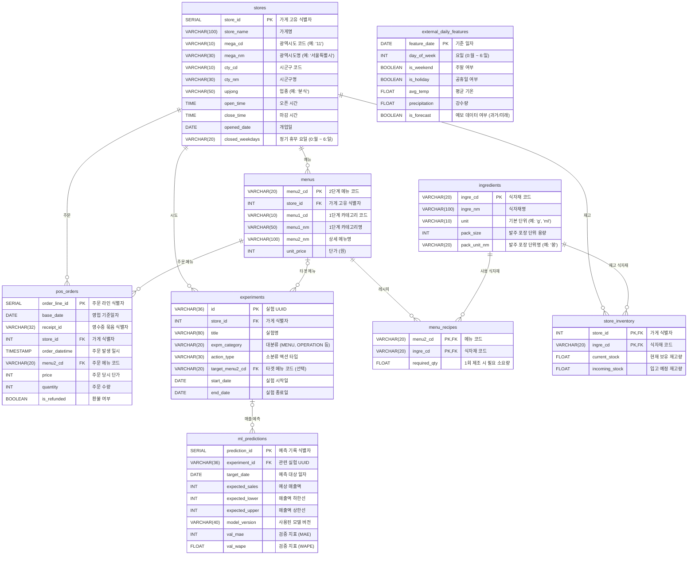

# 트라이로그 ERD

트라이로그는 소상공인이 가게에서 바꿔본 일(시도)을 기록하고, 판매 자료로 전후 결과와 매출 예측을 비교하는 모바일 웹 서비스입니다.
이 문서는 "데이터베이스 스키마 명세서(가게 운영 및 머신러닝 예측 시스템)"의 테이블 9개와 관계를 한 장으로 정리한 것입니다. 컬럼 이름과 타입은 명세서 그대로입니다.

## 다이어그램

## 테이블 설명

| 구분 | 테이블 | 이름 | 역할 |
| --- | --- | --- | --- |
| 마스터 데이터 | `stores` | 가게 정보 마스터 | 가게의 지역(광역시도, 시군구), 업종, 영업시간, 개업일, 정기 휴무 요일. |
| 마스터 데이터 | `menus` | 메뉴 마스터 | 가게별 메뉴. 1단계 카테고리와 2단계 상세 메뉴 코드, 단가. |
| 마스터 데이터 | `ingredients` | 식자재 마스터 | 식자재의 기본 단위와 발주 포장 단위. |
| 트랜잭션 및 재고 관리 | `pos_orders` | POS 주문 원천 데이터 | 주문한 메뉴 한 줄씩의 원본. 같은 영수증의 줄은 `receipt_id`로 묶입니다. |
| 트랜잭션 및 재고 관리 | `store_inventory` | 가게별 재고 현황 | 가게와 식자재별 현재 재고량과 입고 예정량. |
| 트랜잭션 및 재고 관리 | `menu_recipes` | 메뉴별 소요량 레시피 | 메뉴 하나를 만들 때 드는 식자재와 양. |
| 실험 및 머신러닝 예측 | `experiments` | 사장님 시도 기록 | 사장님이 남긴 시도. 분류, 대상 메뉴, 시작일과 종료일. |
| 실험 및 머신러닝 예측 | `ml_predictions` | ML 매출 예측 메타 | 시도와 연결된 날짜별 예상 매출, 상한과 하한, 모델 버전, 검증 지표. |
| 실험 및 머신러닝 예측 | `external_daily_features` | 외부 달력·날씨 데이터 | 날짜별 요일, 주말과 공휴일 여부, 기온, 강수량. 실측과 예보를 구분합니다. |

스키마는 `init_db.sql`로 작성돼 있고, `data/` 폴더에 `ml_predictions`를 뺀 8개 테이블의 샘플 CSV가 있습니다. 백엔드 코드는 아직 이 DB에 연결하지 않았습니다.

## 스키마의 특징

- **주문은 줄 단위 원본으로 저장합니다.** `pos_orders`의 한 행은 주문한 메뉴 하나입니다. `price`에 주문 당시 단가를 남기므로, 나중에 `menus.unit_price`가 바뀌어도 과거 매출은 그대로입니다.
- **일별 집계는 뷰로 계산합니다.** `v_daily_sales_mart`가 `pos_orders`를 `base_date`로 묶어 주문 수(영수증 수), 판매 수량, 매출(단가 × 수량)을 구합니다. 환불 주문은 빼고, 요일·공휴일·날씨를 `external_daily_features`에서 붙입니다. 주문이 없는 날도 행이 생기며 `is_missing_or_closed`로 표시합니다.
- **메뉴는 2단계 코드입니다.** `menu1_cd`가 카테고리, `menu2_cd`가 상세 메뉴입니다. 주문, 레시피, 시도가 모두 `menu2_cd`로 메뉴를 가리킵니다.
- **시도는 2단계로 분류합니다.** `expm_category`가 대분류(MENU, OPERATION, MARKETING), `action_type`이 소분류(MENU_BADGE, PRICE_CHANGE 등)입니다. 확인일과 진행 상태는 저장하지 않고 `start_date`와 `end_date`에서 계산합니다.
- **예측은 날짜별 한 행입니다.** 예상 매출, 상한과 하한, 사용한 모델 버전, 검증 지표(MAE, WAPE)를 같은 행에 둡니다.
- **달력·날씨는 실측과 예보를 한 테이블에 둡니다.** `is_forecast`로 과거 실측과 앞으로의 예보를 구분합니다.
- **식자재 테이블 세 개는 재료 준비량 계산에 씁니다.** 메뉴 판매량에 `required_qty`를 곱해 필요한 양을 구하고, `current_stock`과 `incoming_stock`을 뺀 뒤 `pack_size` 단위로 올립니다.

## 관계

| 부모 | 자식 | 연결 컬럼 | 의미 |
| --- | --- | --- | --- |
| `stores` | `menus` | `store_id` | 가게 하나에 메뉴 여러 개. |
| `stores` | `pos_orders` | `store_id` | 가게 하나에 주문 줄 여러 개. |
| `menus` | `pos_orders` | `menu2_cd` | 메뉴 하나가 여러 주문 줄에 나옵니다. |
| `stores` | `experiments` | `store_id` | 가게 하나에 시도 여러 건. |
| `menus` | `experiments` | `target_menu2_cd` | 시도의 대상 메뉴. 메뉴를 정하지 않은 시도는 비워 둡니다. |
| `experiments` | `ml_predictions` | `experiment_id` | 시도 하나에 날짜별 예측 여러 행. |
| `menus` | `menu_recipes` | `menu2_cd` | 메뉴 하나에 식자재 여러 개. |
| `ingredients` | `menu_recipes` | `ingre_cd` | 식자재 하나가 여러 메뉴에 쓰입니다. |
| `stores` | `store_inventory` | `store_id` | 가게 하나에 식자재별 재고. |
| `ingredients` | `store_inventory` | `ingre_cd` | 식자재 하나가 여러 가게의 재고에 나옵니다. |

`external_daily_features`는 다른 테이블과 키로 연결하지 않고 날짜로 맞춰 씁니다.

## 피드백을 받고 싶은 부분

1. `ml_predictions`는 모델 버전과 검증 지표를 예측 행마다 반복해서 저장합니다. 모델 정보를 별도 테이블로 나누는 것이 나을지 궁금합니다.
2. `external_daily_features`는 날짜만 키라서 지역 구분이 없습니다. 가게가 여러 시군구에 있을 때 날씨를 어떻게 나누는 것이 좋을지 의견을 듣고 싶습니다.
3. 일별 집계를 뷰로 매번 계산합니다. 주문이 늘었을 때 집계 테이블로 바꿔야 하는 기준이 궁금합니다.
