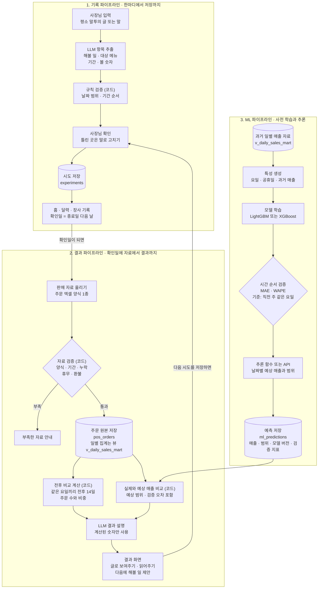

# 트라이로그 데이터 처리 파이프라인 (설계안)

트라이로그는 소상공인이 가게에서 바꿔본 일(시도)을 기록하고, 확인일에 판매 자료를 올려 전후 결과를 비교하는 모바일 웹 서비스입니다.
데이터는 세 갈래로 흐릅니다. 사장님의 한마디를 시도로 저장하는 **기록**, 판매 자료를 비교 결과로 바꾸는 **결과**, 평소 매출 흐름을 예측하는 **ML**입니다.

이 문서는 해커톤 개발 목표를 기준으로 한 설계안입니다. 현재 구현된 범위는 아래 "단계별 설명과 현재 상태" 표에 따로 적었습니다.

## 다이어그램

## 단계별 설명과 현재 상태

| 파이프라인 | 단계 | 담당 | 입력 → 출력 | 현재 상태 |
| --- | --- | --- | --- | --- |
| 기록 | 항목 추출 | LLM | 사장님의 문장 → 해볼 일, 대상 메뉴, 기간, 볼 숫자 | 미구현. 지금은 입력 폼으로 직접 적습니다. |
| 기록 | 규칙 검증·저장 | 웹 서버 | 추출한 항목 → `experiments` | 구현. 저장소는 서버 메모리이며 DB 연결은 해커톤 목표입니다. |
| 기록 | 다시 찾기 | 웹(React) | 저장된 시도 → 홈·달력·장사 기록 | 구현. |
| 결과 | 자료 올리기·검증 | 웹 | 주문 엑셀 → `pos_orders` | 미구현. 목업은 파일 선택까지만 동작합니다. |
| 결과 | 전후 비교 계산 | 웹(코드) | `pos_orders` → 주문 수, 비중의 전후 값 | 가상 수치로 계산하는 예시 화면만 있습니다. |
| 결과 | 예상 매출 비교 | 웹(코드) + ML | 일별 매출 뷰, `ml_predictions` → 차이와 예상 범위 | 미구현. 목업에 화면 예시만 있습니다. |
| 결과 | 결과 설명 | LLM | 계산·예측 결과 → 쉬운 말 설명, 다음 시도 제안 | 미구현. |
| ML | 학습·검증 | ML | 일별 매출 뷰 → 모델, MAE·WAPE | 미구현. 학습 데이터 확보가 선행 조건입니다. |
| ML | 추론 | ML | 날짜 → `ml_predictions` | 미구현. |

테이블 이름은 ERD 문서와 같고, 일별 매출 뷰는 `v_daily_sales_mart`입니다. 사진(POS 화면) 인식, 음성 입력, 확인일 알림 발송, 실제 동네 가게 집계는 해커톤 이후 범위입니다.

## 처리 원칙

- **숫자는 코드가 계산하고, LLM은 이해와 설명만 맡습니다.** LLM이 숫자를 만들어 내지 않도록, 설명 단계에는 계산과 예측이 끝난 값만 넘깁니다.
- **같은 요일끼리 비교합니다.** 변경 전 14일과 변경 후 14일을 요일 구성이 같도록 맞춥니다.
- **주문 수와 비중을 함께 봅니다.** 대상 메뉴 주문이 늘어도 전체 주문이 더 늘었다면 비중은 줄어듭니다. 예: 42건 → 58건, 전체 100건 → 160건이면 비중은 42% → 약 36%입니다.
- **자료가 부족하면 결과 대신 안내를 보여줍니다.** 기간 누락, 휴무일, 환불 처리를 검증하고, 비교할 수 없으면 필요한 자료를 알려줍니다.
- **효과를 단정하지 않습니다.** 전후 변화나 예상과의 차이만으로 시도의 효과라고 말하지 않고, 예측 오차와 같은 기간의 다른 변화를 함께 표시합니다.
- **ML 성능은 단순한 예측과 비교해 확인합니다.** 시간 순서 검증에서 MAE와 WAPE를 "직전 주 같은 요일" 예측과 비교하고, 검증 오차를 화면에 함께 보여줍니다.

## 피드백을 받고 싶은 부분

1. LLM이 뽑은 날짜 표현("다음 주까지")을 코드에서 다시 검증하는 지금 구조가 적절한지 궁금합니다.
2. 가게 한 곳의 몇 달 치 일매출로 LightGBM·XGBoost를 학습하는 것이 "직전 주 같은 요일" 예측보다 의미 있게 나을지 확신이 없습니다.
