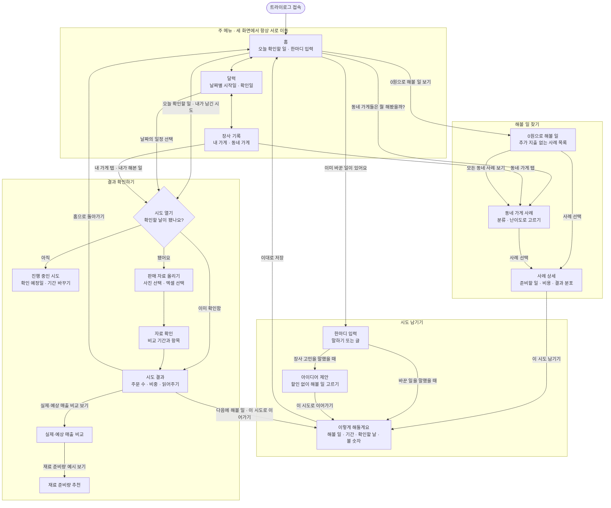

# 트라이로그 유저 플로우 (설계안)

트라이로그는 소상공인이 가게에서 바꿔본 일(시도)을 기록하고, 확인일에 판매 자료를 올려 전후 결과를 비교하는 모바일 웹 서비스입니다.
이 문서는 사장님이 주 메뉴 세 곳(홈, 달력, 장사 기록)에서 어떤 경로로 각 기능에 닿는지를 정리한 것입니다. 동작 목업의 화면 이동을 기준으로 그렸고, 현재 구현과 다른 부분은 아래 표에 따로 적었습니다.

## 다이어그램

## 메뉴별 진입 지점

| 주 메뉴 | 이 화면에서 보이는 것 | 여기서 갈 수 있는 곳 |
| --- | --- | --- |
| 홈 | 처음 방문하면 "0원으로 해볼 일 보기"와 "이미 바꾼 일이 있어요". 시도를 남긴 뒤에는 "오늘 확인할 일", 한마디 입력창, 내가 남긴 시도 목록. | 0원으로 해볼 일, 한마디 입력, 시도 열기, 동네 가게 사례 |
| 달력 | 시도의 시작일과 확인일. 달 이동, 날짜 선택, 오늘로 이동, 이번 달 남은 일정. | 날짜의 일정에서 시도 열기 |
| 장사 기록 | "내 가게" 탭에 내가 해본 일과 결과, "동네 가게" 탭에 분류·난이도별 사례. | 시도 열기, 사례 상세. 기록이 없으면 결과 예시 보기와 홈으로 가는 버튼을 보여줍니다. |

주 메뉴는 홈, 달력, 장사 기록 화면에서만 보입니다. 그 밖의 화면(사례 상세, 대화, 결과 등)에는 뒤로 가기가 있습니다.

## 대표 경로

발표에서 2분 동안 시연할 경로입니다.

1. 홈에서 "0원으로 해볼 일 보기"를 눌러 "메뉴판에 추천 표시 붙이기" 사례를 엽니다.
2. 홈으로 돌아와 "오늘부터 점심 세트 옆에 사장님 추천을 붙일 거야. 다음 주까지 해볼게."라고 남깁니다.
3. 트라이로그가 정리한 해볼 일, 진행 기간, 확인할 날, 볼 숫자를 확인하고 "이대로 저장"을 누릅니다.
4. 확인할 날에 홈을 열면 "오늘 확인할 일"이 맨 위에 보입니다. "결과 보기"를 누릅니다.
5. 판매 자료(주문 엑셀)를 고르고 비교 기간을 확인합니다.
6. 시도 결과에서 주문 수와 비중의 변화를 보고, 실제·예상 매출 비교를 엽니다.
7. "다음에 해볼 일"에서 "이 시도로 이어가기"를 눌러 한 가지만 바꾼 다음 시도를 저장합니다.

## 현재 구현과 다른 부분

| 구간 | 설계(이 문서) | 동작 목업 | 현재 구현 |
| --- | --- | --- | --- |
| 주 메뉴, 달력, 장사 기록 | 세 메뉴 사이 이동 | 동작 | 구현 |
| 해볼 일 찾기 | 사례 목록 → 상세 | 동작. 가상 사례 | 구현. 가상 사례 6개 |
| 사례 상세 → 시도 남기기 | "이 시도 남기기" | 없음 | 구현. 입력 폼으로 이동 |
| 한마디 입력 | 말하기 또는 글을 LLM이 정리 | 정해진 예시 문장만 처리 | 미구현. 입력 폼으로 직접 등록 |
| 판매 자료 올리기 | 주문 엑셀을 올려 비교 | 파일 선택까지 동작 | 미구현 |
| 시도 결과 | 내 자료로 계산한 결과 | 가상 자료로 계산 | 가상 결과 예시 화면만 있음 |
| 실제·예상 매출 비교, 재료 준비량 | ML 예측과 비교 | 화면 예시(가상 수치) | 미구현 |

확인일 알림 발송은 이번 범위에 없습니다. 사장님이 확인할 날에 홈을 열면 "오늘 확인할 일"로 안내합니다.

## 피드백을 받고 싶은 부분

1. 처음 방문한 사장님에게 "해볼 일 찾기"를 먼저 보여주고 "이미 바꾼 일이 있어요"를 접어 둔 순서가 적절한지 궁금합니다.
2. 전체 경로에서 사장님 손이 가장 많이 가는 곳은 판매 자료를 올리는 단계입니다. 이 단계의 부담을 줄일 방법에 대한 의견을 듣고 싶습니다.
3. 결과 화면에서 "다음에 해볼 일"로 바로 이어지는 흐름이 사장님에게 부담스럽지 않을지 고민입니다.
